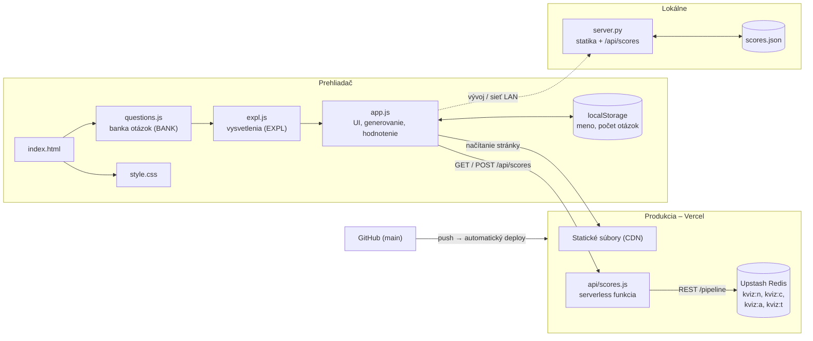
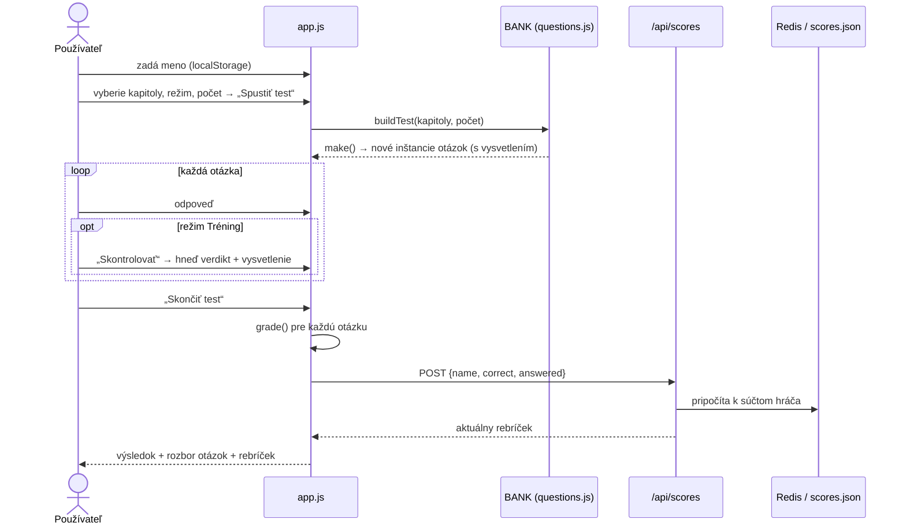

# Kvíz – Signálové mikrokontroléry

Webová aplikácia na precvičovanie učiva z predmetu **Signálové mikrokontroléry** (mikrokontrolér TMS320F2837xD, prednášky 1–6). Generuje testy z banky parametrických otázok, ku každej odpovedi ukazuje stručné vysvetlenie a vedie rebríček podľa počtu správnych odpovedí.

**Nasadenie:** https://sigmik-kviz.vercel.app

## Obsah

- [Funkcie](#funkcie)
- [Architektúra](#architektúra)
- [Tok údajov](#tok-údajov)
- [Štruktúra repozitára](#štruktúra-repozitára)
- [Banka otázok](#banka-otázok)
- [Ako sa generuje test](#ako-sa-generuje-test)
- [Hodnotenie a rebríček](#hodnotenie-a-rebríček)
- [API](#api)
- [Lokálne spustenie](#lokálne-spustenie)
- [Nasadenie na Vercel](#nasadenie-na-vercel)
- [Ako pridať otázky](#ako-pridať-otázky)
- [Správa dát](#správa-dát)
- [Obmedzenia](#obmedzenia)

## Funkcie

- **Výber kapitol** (prednášky 1–6) a **počtu otázok** (5, 10, 15, 20, 30, 40).
- **Dva režimy:** *Test* (vyhodnotenie až na konci, meria sa čas) a *Tréning* (po každej otázke ju možno skontrolovať a prečítať vysvetlenie).
- **Typy otázok:** výber z ABCD, viac správnych odpovedí, pravda/nepravda, číselná odpoveď, doplňanie kódu cez rozbaľovacie polia (vrátane obrázka priebehu PWM), zoraďovanie krokov a priraďovanie pojmov.
- **Parametrické otázky:** pri každom generovaní majú iné čísla (periódy časovača, hodnoty ADC, striedy PWM, …), takže sa nedajú zapamätať.
- **Na precvičenie:** otázky, v ktorých sa hráč pomýlil, sa ukladajú na meno hráča a v záložke *Na precvičenie* ich môže precvičovať (s novými hodnotami); správna odpoveď otázku zo zoznamu odstráni.
- **Vysvetlenie ku každej otázke** – aj pri správnej odpovedi.
- **Čiastočné bodovanie** pri otázkach s viacerými časťami.
- **Meno hráča** pri prvom vstupe (bez mena sa do aplikácie nedá); zariadenie si ho pamätá v `localStorage` aj v dlhodobej cookie, takže ho netreba zadávať znova a **rebríček** podľa počtu správnych odpovedí.
- Menu v hlavičke, varovanie pri odchode z rozpracovaného testu, svetlý aj tmavý režim, responzívne rozloženie.

## Architektúra

Aplikácia je **statická stránka bez build kroku** (HTML + CSS + vanilla JavaScript) a malé **API na rebríček**, ktoré existuje v dvoch zameniteľných implementáciách: lokálny Python server a Vercel serverless funkcia s Upstash Redis.



### Zodpovednosti súborov

| Súbor | Úloha |
|---|---|
| `index.html` | Kostra stránky: hlavička s menu, kontajner `#app`, poradie načítania skriptov. |
| `questions.js` | `LECTURES` (názvy kapitol), pomocné konštruktéry (`S`, `M`, `TF`, `N`, `O`, `P`, `G`) a banka `BANK` so šablónami otázok. |
| `expl.js` | Tabuľka `EXPL` (podreťazec textu otázky → vysvetlenie) a obalenie `make()` tak, aby každá otázka dostala vysvetlenie. |
| `app.js` | Celé UI a stav: úvod, test, výsledky, rebríček, modálne okno s menom, generovanie testu (`buildTest`), hodnotenie (`grade`), komunikácia s API. |
| `style.css` | Vzhľad (premenné farieb, svetlá/tmavá téma, tabuľky, formuláre). |
| `server.py` | Lokálny server: statické súbory + `/api/scores` so súborovým úložiskom. |
| `api/scores.js` | Produkčná implementácia `/api/scores` (Vercel + Upstash Redis). |
| `api/wrong.js` | Chybne zodpovedané otázky na meno hráča (`/api/wrong`, Redis množina `kviz:w:<meno>`); lokálne ho rieši `server.py` (`wrong.json`). |
| `api/me.js` | Zapamätanie mena zariadenia v dlhodobej cookie (`/api/me`); lokálne ho rieši `server.py`. |
| `vercel.json`, `.vercelignore` | Konfigurácia nasadenia, vylúčenie lokálnych súborov z deployu. |
| `spusti.command` | Spúšťač lokálneho servera pre macOS (dvojklik). |

Skripty sa načítavajú ako obyčajné globálne skripty (bez modulov), preto **záleží na poradí**: `questions.js` → `expl.js` → `app.js`.

## Tok údajov



## Štruktúra repozitára

```
.
├── index.html          # kostra stránky
├── style.css           # vzhľad
├── questions.js        # banka otázok
├── expl.js             # vysvetlenia k otázkam
├── app.js              # logika a UI
├── api/
│   ├── scores.js       # Vercel funkcia (rebríček)
│   ├── wrong.js        # chybné otázky na meno
│   └── me.js           # zapamätanie mena (cookie)
├── server.py           # lokálny server (rebríček v scores.json)
├── spusti.command      # spúšťač pre macOS
├── vercel.json         # { "cleanUrls": true }
├── .vercelignore       # čo sa nenahrá na Vercel
├── package.json
├── CLAUDE.md           # poznámky pre Claude Code
└── README.md
```

Zdrojové PDF prednášky **nie sú** súčasťou repozitára.

## Banka otázok

`BANK` je pole definícií `{ lec, topic, type, make() }`:

- `lec` – číslo prednášky (1–6), `topic` – téma (zobrazuje sa pri rozbore),
- `type` – jeden z typov: `single`, `multi`, `tf`, `num`, `select`, `order`, `match` (typ `text` je v kóde podporovaný, ale nepoužíva sa – otázky na pamäťové vybavenie názvov registrov boli zámerne nahradené ABCD),
- `make()` – vráti **novú inštanciu** otázky pri každom volaní; parametrické otázky tu losujú čísla.

Pomocné konštruktéry v `questions.js`:

| Pomocná funkcia | Typ | Poznámka |
|---|---|---|
| `S(lec, topic, text, správna, [nesprávne…], vysvetlenie)` | jedna správna z ABCD | z nesprávnych sa náhodne vyberú 3, poradie sa zamieša |
| `M(…)` | viac správnych | čiastočné bodovanie |
| `TF(lec, topic, tvrdenie, pravda, vysvetlenie)` | pravda / nepravda | |
| `N(lec, topic, text, odpoveď, tolerancia, jednotka, …)` | číselná odpoveď | fixná hodnota |
| `O(lec, topic, text, kroky, …)` | zoraďovanie | zobrazí sa ako tabuľka s výberom poradia |
| `P(lec, topic, text, páry, …)` | priraďovanie | náhodne sa vyberú 4 páry |
| `G(lec, topic, typ, () => ({…}))` | ľubovoľný typ | používa sa pre parametrické otázky a doplňanie kódu |

Banka obsahuje **482 šablón** (prednáška 1: 131, 2: 75, 3: 80, 4: 43, 5: 83, 6: 70) z prednášok aj z učebnice (blok „Doplnené otázky z učebnice“ na konci `questions.js`) a viaceré z nich generujú nekonečne veľa variantov (výpočty časovačov, PWM, ADC, eQEP, kódy PIE/IER, priebeh AQCTL).

## Ako sa generuje test

`buildTest(kapitoly, počet)` v `app.js`:

1. Zo `BANK` vyberie šablóny vybraných kapitol.
2. Zostaví zamiešanú postupnosť **typov otázok** podľa kvóty (`QUOTA`: prevažne ABCD, potom viac správnych, pravda/nepravda, číselné, doplňanie kódu, zoraďovanie, priraďovanie).
3. Pre každý typ vyberie šablónu z kapitoly, z ktorej je zatiaľ v teste najmenej otázok (rovnomerné pokrytie kapitol), a žiadnu šablónu nepoužije dvakrát.
4. Ak sa kvóta nedá naplniť, doplní zvyšné šablóny ľubovoľného typu.
5. Zavolá `make()` – vzniknú konkrétne otázky (s losovanými číslami) a zamiešajú sa.

Ak vybrané kapitoly nemajú dosť šablón, test je kratší.

## Hodnotenie a rebríček

**Hodnotenie otázky** (`grade`, 0–1 bod):

| Typ | Pravidlo |
|---|---|
| ABCD, pravda/nepravda | 1 / 0 |
| viac správnych | `(správne zvolené − nesprávne zvolené) / počet správnych`, minimum 0 |
| číselná odpoveď | 1, ak je hodnota v tolerancii (čiarka aj bodka ako desatinný oddeľovač) |
| doplňanie, zoraďovanie, priraďovanie | podiel správne vyplnených polí |

**Rebríček:** po skončení testu (v režime Test aj Tréning, ľubovoľná dĺžka) sa k hráčovi pripočíta:

- `correct` – počet **plne správnych** odpovedí,
- `answered` – počet **zodpovedaných** otázok (nezodpovedané sa nerátajú),
- `tests` – počet dokončených testov.

Poradie: podľa `correct` zostupne, pri rovnosti podľa úspešnosti `correct / answered`. Hráči sa rozlišujú podľa mena (bez ohľadu na veľkosť písmen, max. 20 znakov).

## API

Jediný koncový bod `/api/scores`; lokálny server aj Vercel funkcia dodržiavajú rovnaký kontrakt.

**`GET /api/scores`** → pole (max. 50 riadkov):

```json
[{ "name": "Jano", "correct": 42, "answered": 60, "tests": 4, "pct": 0.7 }]
```

**`GET` / `POST /api/me`** – meno zariadenia v cookie `kviz_name` (400 dní, `HttpOnly`): `GET` vráti `{ "name": "…" }`, `POST {name}` ho nastaví.

**`GET /api/wrong?name=…`** → `{ "ids": ["3.12", …] }`; **`POST /api/wrong`** `{ name, add: [ids], remove: [ids] }` pridá/odoberie ID šablón a vráti aktuálny zoznam.

**`POST /api/scores`**

```json
{ "name": "Jano", "correct": 14, "answered": 20 }
```

Podmienky: meno 1–20 znakov, `1 ≤ answered ≤ 100`, `0 ≤ correct ≤ answered`; inak `400`. Odpoveď: `{ "board": [ …rebríček… ] }`. Bez pripojenej databázy vráti Vercel funkcia `503` a aplikácia zobrazí „Rebríček nie je dostupný“.

**Úložisko**

| Prostredie | Kde | Formát |
|---|---|---|
| Lokálne | `scores.json` (v `.gitignore`) | slovník `meno_malými → {name, correct, answered, tests}` |
| Vercel | Upstash Redis | štyri hashe: `kviz:n` (zobrazené meno), `kviz:c` (správne), `kviz:a` (zodpovedané), `kviz:t` (testy); pole = meno malými písmenami, pripočítanie cez `HINCRBY`; k tomu množina `kviz:w:<meno>` s ID chybných šablón (`SADD`/`SREM`) |

## Lokálne spustenie

Potrebný je len Python 3 (žiadne závislosti).

```bash
./spusti.command          # macOS, dvojklik funguje tiež
# alebo
python3 server.py         # → http://localhost:8080
```

Server počúva na `0.0.0.0:8080`, takže ho možno otvoriť aj z iných zariadení v sieti (`http://<názov-počítača>.local:8080`). Rebríček sa ukladá do `scores.json`. Súbory `server.py` a `scores.json` server navonok nezverejňuje.

## Nasadenie na Vercel

1. Importuj repozitár vo Verceli (**Framework: Other**, bez build príkazu a výstupného adresára).
2. V projekte: **Storage → Create → Upstash Redis** (Marketplace) a pripoj ho k projektu. Premenné `KV_REST_API_URL` a `KV_REST_API_TOKEN` sa pridajú automaticky (podporené sú aj `UPSTASH_REDIS_REST_URL` / `UPSTASH_REDIS_REST_TOKEN`).
3. **Redeploy** (premenné sa načítajú až pri novom nasadení).

Každý `git push` do vetvy `main` spustí automatický deploy. `.vercelignore` vylúči `server.py`, `spusti.command`, `scores.json` a `README.md`.

## Ako pridať otázky

1. V `questions.js` pridaj volanie pomocnej funkcie do sekcie príslušnej prednášky, napr.

   ```js
   S(3, "Time-base", "Ako sa volá register periódy časovej základne ePWM?",
     "TBPRD", ["TBCTR", "TBCTL", "CMPA"],
     "TBPRD určuje maximálnu hodnotu, do ktorej čítač počíta.");
   ```

2. **Každá otázka musí mať vysvetlenie** – buď ako posledný argument, alebo záznam v `EXPL` v `expl.js` (kľúč je podreťazec textu otázky).
3. Pre parametrickú otázku použi `G(lec, topic, typ, () => { …losovanie…; return {text, …, expl}; })` s pomocnými `R(od, do)`, `pick(pole)`, `shuffle(pole)`.
5. **ID šablóny** (napr. `3.12` = 12. šablóna prednášky 3 v poradí v banke) sa používa v zozname chýb. Preto nové otázky pridávaj vždy len **na koniec** `questions.js` a existujúce nemaž ani nepreraďuj.
4. Nové číslo prednášky treba doplniť aj do `LECTURES`.

Žiadny build ani test nie je potrebný – stačí obnoviť stránku.

## Správa dát

Záznamy v produkčnom rebríčku sa dajú meniť len v konzole Upstash (Data Browser alebo CLI). API na mazanie zámerne neexistuje. Zmazanie hráča (meno malými písmenami):

```
HDEL kviz:n meno
HDEL kviz:c meno
HDEL kviz:a meno
HDEL kviz:t meno
```

Úplné vynulovanie rebríčka: `DEL kviz:n kviz:c kviz:a kviz:t`.

## Obmedzenia

- Meno nie je overené – ide o označenie v rebríčku, nie o prihlásenie. Kto pozná API, môže doň zapísať ľubovoľné čísla.
- Zapisovanie do Redisu nie je chránené proti súbežným zápisom nad rámec atómových `HINCRBY`; pre malú skupinu študentov to stačí.
- Stav rozpracovaného testu sa neukladá – po obnovení stránky sa stratí.
